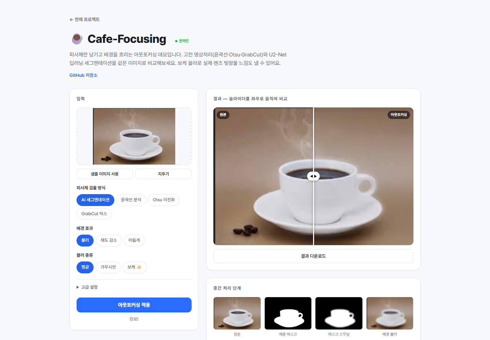
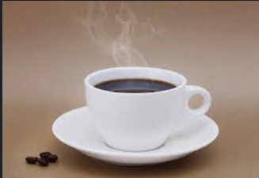
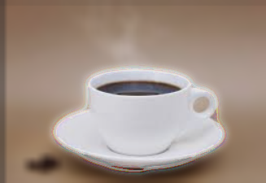
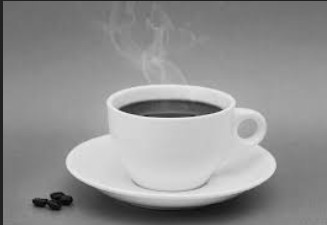
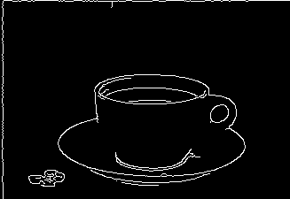
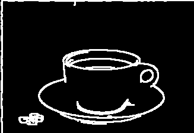
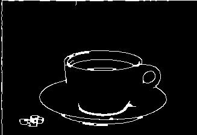
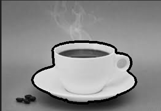
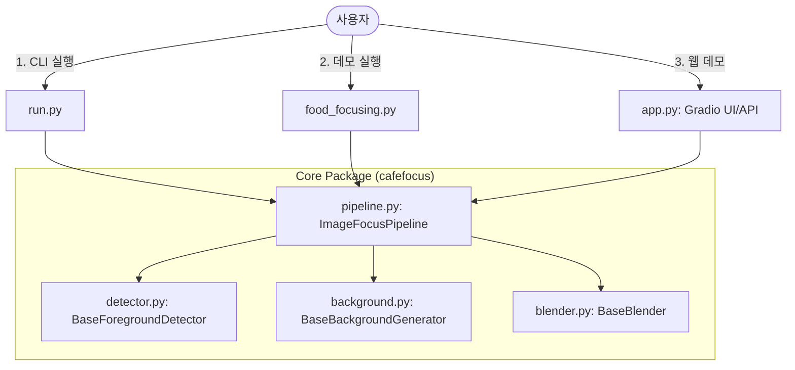
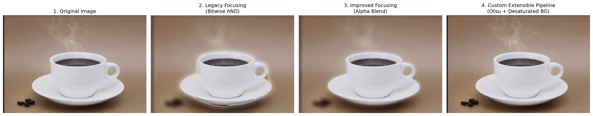

# ☕ 카페 포커싱 (Cafe-Focusing)

> **피사체의 실제 윤곽을 따라 배경만 흐리게 만듭니다.**
> **Project Date:** 2021.10 ~ 2021.12 · **2인 팀 프로젝트** (2026.06 리팩터링 · 2026.08 확장)
> **Platform:** Python 패키지 + CLI · Gradio 웹 데모 (Hugging Face Spaces) · Docker
> **Live Demo:** [demo-gateway.trealight112.workers.dev/cafe-focusing](https://demo-gateway.trealight112.workers.dev/cafe-focusing/)
> **Role:** 알파 블렌딩 합성 설계·구현 · 합성 방식 선택 구조(`--legacy`) 리팩터링

스마트폰 기본 카메라의 음식·인물 필터는 화면 중앙의 **고정된 원형 영역**에만 초점을 맞춰, 세로로 긴 음료잔이나 모양이 불규칙한 빵은 피사체까지 함께 흐려집니다. Cafe-Focusing은 **OpenCV 에지·윤곽선(Contour) 분석으로 피사체 외곽을 찾아 그 바깥만 아웃포커싱**하는 라이브러리이자 도구입니다.

처음에는 딥러닝 없이 OpenCV 연산만으로 구현했고, 2026.08 확장에서 **U2-Net 세그멘테이션(onnxruntime CPU 추론) · GrabCut 박스 지정 · 보케(Bokeh) 블러**를 더해 네 가지 검출 방식을 같은 이미지로 비교할 수 있게 했습니다.

---

## 📱 실제 화면

| 라이브 데모 |
|:---:|
|  |
| 샘플 이미지에 아웃포커싱을 적용하고 슬라이더로 원본과 비교 |

| 원본 | 아웃포커싱 결과 |
|:---:|:---:|
|  |  |
| 입력 이미지 | 윤곽선 바깥 배경만 흐리게 합성한 최종 결과 |

**처리 단계 (윤곽선 검출기 기준)**

| 1. 원본 | 2. 그레이스케일 | 3. 에지 검출 | 4. 에지 팽창 |
|:---:|:---:|:---:|:---:|
|  |  |  |  |
| 입력 이미지 | 밝기 정보만 남김 | Canny로 1차 에지 추출 | 끊어진 에지를 굵게 이어 붙임 |

| 5. 에지 침식 | 6. 외곽선 탐지 | 7. 마스크 스무딩 | 8. 아웃포커싱 완료 |
|:---:|:---:|:---:|:---:|
|  |  |  |  |
| 굵어진 에지와 잔 노이즈를 깎아냄 | 넓이가 가장 큰 외곽선 하나만 선택 | 가우시안 블러로 마스크 경계를 부드럽게 | 마스크를 가중치로 원본과 흐린 배경을 합성 |

---

## 📖 프로젝트 개요

고정된 원형 필터는 피사체 모양을 보지 않기 때문에, 원 밖으로 벗어난 잔 손잡이나 빵 가장자리가 배경과 같이 흐려집니다.
Cafe-Focusing은 그 한계를 **에지 검출 → 모폴로지 → 최대 외곽선 → 마스크 스무딩 → 합성** 순서의 이미지 처리로 풉니다.

* **원이 아닌 실제 윤곽** — 가장 바깥 외곽선 중 넓이가 가장 큰 것을 피사체로 보고 마스크를 만듦
* **가벼운 구현에서 출발** — 2021년 원본은 영역분할 AI 없이 OpenCV 함수(에지 검출 · 윤곽 검출 · 블러)만 사용
* **갈아 끼우는 구조** — 검출기 · 배경 처리 · 합성을 각각 추상 클래스로 분리해 조합을 바꿔 가며 실행

### 💡 주요 기능

| 기능 | 설명 |
|---|---|
| 🎯 **피사체 검출 4종** | 윤곽선(Canny + Contour) · Otsu 이진화 · GrabCut 박스 지정 · U2-Net AI 세그멘테이션 중 선택 |
| 🌫️ **배경 효과** | 블러(평균 · 가우시안 · 보케)에 채도 감소 또는 어둡게 효과를 겹쳐 적용 |
| 🧪 **합성 방식 2종** | 알파 블렌딩(기본)과 레거시 `bitwise_and` 합성을 `--legacy` 옵션으로 전환 |
| 🔍 **처리 단계 저장** | `--save-steps`로 그레이스케일부터 최종 합성까지 중간 이미지를 단계별 PNG로 저장 |
| 🌐 **웹 데모 · API** | Gradio UI에서 이미지를 올려 검출 방식과 파라미터를 바꿔 보고, 같은 파이프라인을 API로 호출 |

---

## 🏗️ 아키텍처 — 검출 · 배경 · 합성 3단 파이프라인

핵심 로직은 `cafefocus/` 패키지에 모으고, CLI(`run.py`) · 시각화 스크립트(`food_focusing.py`) · 웹 데모(`app.py`)가 모두 같은 `ImageFocusPipeline`을 호출합니다.



**처리 흐름 (이미지 한 장 → 아웃포커싱 결과)**

1. 검출기(Detector)가 피사체를 찾아 0~255 값의 스무딩 마스크를 반환
2. 배경 생성기(Background Generator)가 원본 전체에 블러 · 채도 감소 · 어둡게 효과를 적용
3. 블렌더(Blender)가 마스크를 가중치로 원본과 처리된 배경을 합성
4. 각 단계의 중간 이미지를 하나의 딕셔너리로 모아 결과와 함께 반환

**라이브 데모 구성 (정적 호스팅 + 연산 서버 2-티어)**

```text
[커스텀 프론트엔드]                         [백엔드 API]
Cloudflare (demo-gateway/cafe-focusing/) ──▶ Hugging Face Spaces (Gradio API)
드래그앤드롭·Ctrl+V 입력,                     app.py — cafefocus 파이프라인을
원본↔결과 비교 슬라이더,                      REST API로 노출 (CPU 실행)
처리 단계 갤러리
```

* **프론트엔드:** [demo-gateway 저장소](https://github.com/Kim-jin-gwang/demo-gateway)의 `cafe-focusing/` — 브라우저에서 `@gradio/client`로 API 호출
* **백엔드:** 이 저장소의 `app.py` 기반 → [HF Space `kimjgwang/ml-demos`](https://huggingface.co/spaces/kimjgwang/ml-demos) (무료 티어 Space 개수 제한으로 GreenGlossary와 통합 호스팅)
* **서버 보호:** 긴 변이 1,600px를 넘는 이미지는 축소한 뒤 처리

> 처리 전체가 OpenCV 연산과 CPU 추론이라 GPU가 필요 없어, Space 기동 요건만 더미 함수로 충족하고 실제 연산은 방문자별 ZeroGPU 쿼터를 쓰지 않도록 CPU에서 직접 실행합니다.

---

## 🧩 피사체 검출 방식 4종

검출기는 모두 같은 인터페이스(`detect(img) → 마스크, 중간 단계`)를 따르므로 `--detector` 옵션 하나로 바꿔 끼울 수 있습니다.

| 방식 | 동작 | 맞는 상황 |
|---|---|---|
| **윤곽선 (Contour)** — 기본값 | Canny 에지 → 팽창 · 침식 → 최외곽 Contour 중 최대 넓이 선택 → 마스크 팽창 · 침식 → 가우시안 스무딩 | 2021년 원본 방식. 딥러닝 없이 OpenCV 함수만 사용 |
| **Otsu 이진화** | 가우시안 블러로 노이즈를 줄인 뒤 Otsu 임계값으로 이진화하고 최대 Contour를 마스크로 사용 | 배경과 대비가 큰 피사체 |
| **GrabCut (박스 지정)** | 사용자가 피사체 둘레에 박스(정규화 좌표 x,y,w,h)를 주면 그 안에서 전경과 배경을 반복 분리 | 자동 검출이 엉뚱한 피사체를 고를 때 |
| **AI 세그멘테이션 (U2-Net)** | 320×320으로 줄여 U2-Net 돌출 객체 검출을 onnxruntime CPU로 추론하고 원본 크기로 복원 | 배경이 복잡한 사진 |

**배경 처리와 합성**

| 구분 | 선택지 | 설명 |
|---|---|---|
| **블러 종류** | 평균(기본) · 가우시안 · 보케 | 보케는 원형(disc) 커널로 필터링하고, 그 전에 밝은 영역을 강조해 빛망울이 원 모양으로 번지게 함 |
| **배경 효과** | 블러 · 채도 감소 · 어둡게 | 채도 감소와 어둡게는 블러를 먼저 적용한 뒤 겹쳐 적용 |
| **합성** | 알파 블렌딩(기본) · 레거시 `bitwise_and` | 알파 블렌딩은 `alpha * 원본 + (1 - alpha) * 배경` 선형 합성, 레거시는 흰 배경 위에 전경 · 배경을 따로 분리해 비트 연산으로 병합 |

---

## 🛠️ 기술 스택

| 영역 | 스택 |
|---|---|
| **언어** |  |
| **이미지 처리** |   Canny · Contour · 모폴로지 · GrabCut · Otsu |
| **AI** |  U2-Net 돌출 객체 검출 (CPU 추론, 모델 약 170MB 자동 다운로드) |
| **데모 · 시각화** |  Matplotlib (단계별 · 비교 차트) |
| **인프라** |    |

---

## 💥 트러블 슈팅

### 1. Canny 에지만으로는 윤곽선이 끊기고 노이즈가 섞였다
* **현상:** Canny Edge만 쓰면 피사체 외곽선 말고도 주변 조명이나 물방울이 에지로 잡히고, 정작 주요 선은 중간중간 끊어짐.
* **원인:** 이미지의 세밀한 조명 변화와 유리잔 표면 반사광까지 에지로 인식.
* **해결:** 에지 검출 뒤에 모폴로지 연산을 추가. `cv2.dilate`(팽창)로 끊어진 얇은 에지를 굵게 이어 닫힌 도형을 만들고, `cv2.erode`(침식)로 불필요한 배경 노이즈를 깎아내 닫힌 윤곽선을 확보.

### 2. 마스크 경계가 오려 붙인 것처럼 날카로웠다
* **현상:** 추출한 외곽선으로 마스크를 씌우면 피사체 경계가 잘라 붙인 것처럼 거칠게 분리됨.
* **원인:** 다각형 마스크의 경계 픽셀이 0과 255로 급격히 바뀌는 이진 형태.
* **해결:** 마스크에 팽창과 침식을 다시 적용해 테두리를 다듬고 가우시안 블러로 스무딩해, 경계 부근에 완만한 그라데이션이 생기도록 함.

### 3. 레거시 합성(`bitwise_and`)에서 테두리 잔상과 색 번짐이 남았다
* **현상:** 피사체와 배경을 분리해 배경만 블러 처리한 뒤 `bitwise_and`로 병합하면 경계에 흰 테두리 잔상이 남고 피사체 색이 번져 보임.
* **원인:** 흰 배경 위에 분리한 이미지에 블러를 걸면 경계 픽셀이 뭉개지는데, 비트 논리 연산은 그 연속적인 값 변화를 그대로 반영하지 못함.
* **해결:** 원본 전체를 흐리게 만든 배경 이미지를 따로 만들고, 스무딩 마스크를 0.0~1.0 알파 가중치로 정규화해 `alpha * 원본 + (1 - alpha) * 배경`으로 선형 합성하는 알파 블렌딩으로 전환. 기존 방식은 `--legacy` 옵션으로 남겨 두 결과를 비교할 수 있게 함.

<p align="center">
  
</p>

---

## 📂 디렉터리 구조

```text
Cafe-Focusing/
├── cafefocus/            # 아웃포커싱 핵심 패키지
│   ├── pipeline.py       # 검출 → 배경 → 합성을 잇는 ImageFocusPipeline
│   ├── detector.py       # 피사체 검출기 — Contour · Otsu · GrabCut · U2-Net
│   ├── background.py     # 배경 처리 — 블러(평균 · 가우시안 · 보케) · 채도 감소 · 어둡게
│   └── blender.py        # 합성 — AlphaBlender · LegacyAndBlender
├── app.py                # Gradio 웹 UI / API 서버 (HF Spaces 배포)
├── run.py                # CLI 실행 스크립트
├── food_focusing.py      # 합성 방식 비교 · 처리 단계 시각화 스크립트
├── Dockerfile            # 데모 서버 이미지 (python:3.12-slim)
├── requirements.txt      # 의존성 목록
├── docs/                 # 프로젝트 소개 발표 자료 (pptx)
└── example_process_img/  # 예제 이미지 · 단계별 결과 · 비교 차트
```

---

## 🚀 실행 방법

**요구 사항:** Python 3 · pip (또는 Docker만 있어도 실행 가능)

```bash
# 도커로 데모 실행 → http://localhost:7860
docker build -t cafe-focusing .
docker run -p 7860:7860 cafe-focusing

# 로컬 설치 후 실행
pip install -r requirements.txt
python app.py                                             # Gradio 데모 :7860
python run.py example_process_img/food_solo.png           # 기본 실행 → focused_result.png
python run.py example_process_img/food_solo.png --legacy  # 레거시 bitwise_and 합성
python run.py example_process_img/food_solo.png --detector otsu
python run.py example_process_img/food_solo.png --bg-effect desaturate --bg-blur-type gaussian --saturation 0.2
python run.py example_process_img/food_solo.png --detector ai --bg-blur-type bokeh --bg-blur 25
python run.py example_process_img/food_solo.png --detector grabcut --grabcut-rect 0.2,0.15,0.6,0.7
python run.py example_process_img/food_solo.png --save-steps --steps-dir my_processing_steps
python food_focusing.py                                   # 비교 · 단계 차트를 example_process_img/에 생성
```

AI 세그멘테이션은 첫 사용 시 U2-Net 모델(약 170MB)을 `models/`에 자동으로 내려받습니다. 전체 옵션은 `python run.py --help`로 확인할 수 있습니다.

---

## 📚 문서

| 문서 | 내용 |
|---|---|
| [food_focusing_introduce.pptx](docs/food_focusing_introduce.pptx) | 프로젝트 소개 발표 자료 |
| [pipeline_processing_steps.png](example_process_img/pipeline_processing_steps.png) | 처리 단계를 한 장으로 모은 시각화 차트 |
| [focusing_comparison_result.png](example_process_img/focusing_comparison_result.png) | 레거시 합성 · 알파 블렌딩 · Otsu 파이프라인 결과 비교 차트 |
| [demo-gateway](https://github.com/Kim-jin-gwang/demo-gateway) | 라이브 데모 프론트엔드 저장소 |
